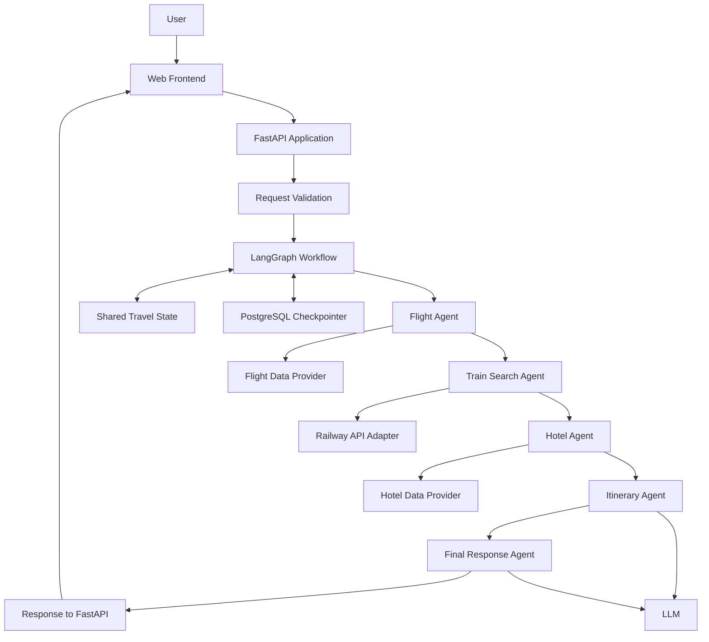

# ✈️ TripMate-AI — Multi-Agent Travel Planner with LangGraph

An AI-powered travel planning application built using **Python, LangGraph, FastAPI, Groq LLMs, and PostgreSQL**. TripMate-AI is designed to coordinate specialized AI agents to help users plan trips, explore travel options, and generate personalized itineraries through a simple web interface.

The project demonstrates an end-to-end AI application workflow, including multi-agent orchestration, API development, persistent conversation state, frontend integration, and Docker-based deployment.

---

## 📌 Table of Contents

1. [Project Overview](#-project-overview)
2. [Project Objectives](#-project-objectives)
3. [Key Features](#-key-features)
4. [System Architecture](#-system-architecture)
5. [End-to-End Workflow](#-end-to-end-workflow)
6. [Technology Stack](#-technology-stack)
7. [AI Agent Components](#-ai-agent-components)
8. [Application Components](#-application-components)
9. [Project Structure](#-project-structure)
10. [Prerequisites](#-prerequisites)
11. [Installation and Setup](#-installation-and-setup)
12. [Environment Configuration](#-environment-configuration)
13. [Run the Application](#-run-the-application)
14. [API Documentation](#-api-documentation)
15. [Docker Deployment](#-docker-deployment)
16. [Train Search Integration](#-train-search-integration)
17. [Database and Conversation Persistence](#-database-and-conversation-persistence)
18. [Security Considerations](#-security-considerations)
19. [Future Enhancements](#-future-enhancements)
20. [Learning Outcomes](#-learning-outcomes)

---

## 🌍 Project Overview

TripMate-AI is a multi-agent travel planning application that uses Large Language Models (LLMs) and graph-based orchestration to organize travel-related tasks into specialized components.

Instead of relying on a single LLM prompt for the entire planning process, the application separates responsibilities across multiple agents. Each agent processes a specific part of the travel-planning workflow, and the resulting information is passed to subsequent agents.

The application is designed around the following core components:

- **Flight Agent:** Handles flight-related travel information and search results.
- **Hotel Agent:** Handles accommodation-related information.
- **Train Search Agent:** Designed to support railway search through a provider-specific adapter.
- **Itinerary Agent:** Combines available travel information into a proposed itinerary.
- **Final Response Agent:** Produces a consolidated, user-friendly response.
- **LangGraph:** Orchestrates the agent workflow and manages shared state.
- **PostgreSQL:** Supports persistent graph checkpoints and conversation continuity.
- **FastAPI:** Exposes the backend through HTTP endpoints.
- **Web Interface:** Provides a user-friendly interface for submitting travel requests and viewing results.
- **Docker:** Packages the application and its Python dependencies into a container.

The goal is to demonstrate how a modular, stateful AI application can be designed, developed, tested, and deployed.

## 🎯 Project Objectives

- Build a multi-agent AI application using LangGraph.
- Divide a complex travel-planning task into specialized agent responsibilities.
- Maintain shared state between agents throughout the workflow.
- Integrate LLM-powered reasoning using Groq-compatible chat models.
- Expose application functionality through REST APIs using FastAPI.
- Maintain conversation continuity using PostgreSQL-backed graph checkpointing.
- Develop an interactive frontend using HTML, CSS, and JavaScript.
- Support structured inputs such as travel preferences, stations, dates, and travel classes.
- Package and run the application using Docker.
- Establish an extensible architecture for future integration with real travel-data providers.

## ✨ Key Features

### Multi-agent orchestration
Coordinates multiple specialized agents through a graph-based workflow rather than implementing all responsibilities in a single function.

### LLM-powered responses
Uses a configured Groq chat model to generate and consolidate natural-language travel-planning responses.

### Shared state management
Passes user requests, flight results, hotel results, train results, itinerary information, and other workflow data between graph nodes.

### Persistent conversations
Uses LangGraph checkpointing with PostgreSQL to support state persistence associated with conversation threads.

### Interactive web application
Allows users to enter travel requests, submit them to the backend, and view the generated response.

### REST API
Provides a FastAPI endpoint for travel requests, plus health-check and automatically generated API documentation endpoints.

### Train-search extension
Provides an architectural extension point for railway search. Until a real provider is configured, train results must be treated as demonstration data or the provider must be reported as unconfigured.

### Containerized deployment
Uses Docker to create a reproducible runtime environment for the application.

---

## 🏗️ System Architecture

The following diagram represents the intended application architecture. Exact node names and connections should match the graph implemented in `backend.py`.



**Architecture note:** The train node and railway adapter are intended integration points. Live train search depends on a documented, authorized provider. Flight, hotel, and train data-provider availability depends on the integrations actually implemented and configured in the application.

### Architecture layers

| Layer | Responsibility | Main technologies |
|---|---|---|
| Presentation | User input and response display | HTML, CSS, JavaScript |
| API | Request validation and HTTP responses | FastAPI, Pydantic |
| Orchestration | Agent coordination and shared state | LangGraph |
| AI/LLM | Natural-language reasoning and response generation | Groq, LangChain |
| Integration | Travel-data retrieval | Provider-specific adapters |
| Persistence | Graph checkpoints and conversation state | PostgreSQL, LangGraph checkpointer |
| Deployment | Application packaging and runtime | Docker, Uvicorn |

---

## 🔄 End-to-End Workflow

The application follows a request-processing workflow.

1. **User submits a request:** The user enters a travel-planning request through the web interface.
2. **Frontend sends the request:** JavaScript sends a JSON payload to the FastAPI backend.
3. **Request validation:** FastAPI validates the message and optional structured travel details.
4. **Workflow initialization:** The backend prepares the initial state and conversation thread configuration.
5. **Flight processing:** The flight agent processes flight-related information using the available implementation.
6. **Train processing:** The train-search node can validate journey inputs and call a configured adapter. Without a real provider, it must not report live schedules or seat availability.
7. **Hotel processing:** The hotel agent handles accommodation-related information.
8. **Itinerary generation:** The itinerary agent combines relevant travel information into a proposed plan.
9. **Final response generation:** The final agent produces a consolidated response.
10. **Checkpointing:** The configured LangGraph/PostgreSQL integration persists graph state according to its checkpoint configuration.
11. **API response:** FastAPI returns the answer and relevant workflow results as JSON.
12. **Frontend rendering:** The browser displays the response and any supported result sections.

The actual execution order and conditional routing depend on the graph edges configured in `backend.py`.

---

## 🤖 AI Agent Components

### 1. Flight Agent

**Purpose:** Process flight-related information for a travel request.

Responsibilities may include:
- Understanding flight search requirements.
- Extracting departure and destination information.
- Processing flight search results returned by the configured provider.
- Passing flight information to downstream agents.

A live flight search requires a working provider integration and valid credentials.

### 2. Train Search Agent

**Purpose:** Introduce railway search into the multi-agent workflow.

Expected inputs:

- Departure station
- Arrival station
- Journey date
- Travel class

Expected normalized outputs:

- Train name
- Train number, when provided
- Departure and arrival times
- Availability information, when supported by the provider
- Data source and search status

The train agent should use a provider-independent adapter so that API-specific authentication, requests, and response mapping remain separate from LangGraph orchestration.

**Current integration constraint:** No railway provider or API documentation has been supplied. The live API implementation must remain disabled until an authorized provider and its actual API contract are available. Mock results must be clearly labelled as sample data.

### 3. Hotel Agent

**Purpose:** Process accommodation-related information.

Responsibilities may include:
- Understanding destination and accommodation preferences.
- Processing hotel search results from the configured implementation.
- Providing relevant information to the itinerary agent.

Live hotel availability and pricing require a suitable provider integration.

### 4. Itinerary Agent

**Purpose:** Organize travel information into a proposed itinerary.

Responsibilities may include:
- Combining available transportation and accommodation information.
- Organizing activities or destinations into a logical plan.
- Respecting the user's stated travel preferences.
- Identifying missing information and unverified results.

### 5. Final Response Agent

**Purpose:** Generate the final user-facing answer.

Responsibilities may include:
- Consolidating the outputs of preceding agents.
- Producing readable, structured travel recommendations.
- Identifying unavailable or unverified data.
- Avoiding unsupported claims about prices, schedules, and availability.

---

## 🧰 Technology Stack

| Technology | Role |
|---|---|
| Python 3.11 | Backend programming language and container runtime |
| LangGraph | Stateful multi-agent workflow orchestration |
| LangChain | LLM integration and related abstractions |
| Groq | Configured LLM inference provider |
| FastAPI | REST API framework |
| Pydantic | Request validation and data models |
| Uvicorn | ASGI application server |
| PostgreSQL | Persistent storage for graph checkpoints |
| LangGraph PostgreSQL checkpointer | Checkpoint persistence and thread-based state recovery |
| HTML5 | Web page structure |
| CSS3 | Styling and responsive layout |
| JavaScript | Frontend interaction and API communication |
| Marked | Markdown rendering, if enabled in the frontend |
| html2pdf.js | Client-side PDF export, if enabled in the frontend |
| Docker | Containerization |
| Git and GitHub | Source control and project hosting |

Exact package versions should be maintained in `requirements.txt`.

---

## 🧩 Application Components

### Frontend
Provides the interface for entering travel requests, selecting supported journey options, displaying responses, and using available copy or export functions.

### FastAPI backend
Handles:
- The home page route.
- Travel-planning requests.
- Input validation.
- Backend workflow invocation.
- JSON response formatting.
- Health checks.

### LangGraph workflow
Defines the graph state, node functions, transitions, execution order, and checkpoint configuration.

### Travel state
The shared state can include fields such as:

```python
class TravelState(TypedDict):
    messages: Annotated[list[AnyMessage], operator.add]
    user_query: str
    flight_results: str
    hotel_results: str
    itinerary: str
    llm_calls: int

    # Add these fields when train integration is enabled.
    departure_station: str
    arrival_station: str
    journey_date: str
    travel_class: str
    train_results: str
```

This is an illustrative schema. The final definition must match the actual fields used by your graph nodes.

### Database and checkpointing
PostgreSQL is used with the configured LangGraph checkpointer to persist graph state. The application must initialize the database schema according to the checkpointer's setup requirements.

### Docker container
The Docker image installs Python dependencies, copies application code, exposes port 8000, and starts Uvicorn.

---

## 📁 Project Structure

A typical project layout is shown below. Keep only files that actually exist in your repository.

```text
TripMate-AI/
│
├── app.py
├── backend.py
├── train_adapter.py
│
├── requirements.txt
├── Dockerfile
├── .dockerignore
├── .gitignore
├── .env.example
├── README.md
│
├── templates/
│   └── index.html
│
└── static/
    ├── style.css
    └── script.js
```

### Important files

| File | Description |
|---|---|
| `app.py` | FastAPI application, routes, and request models |
| `backend.py` | LangGraph state, agent nodes, graph construction, and workflow invocation |
| `train_adapter.py` | Proposed railway provider abstraction and mock-mode logic |
| `requirements.txt` | Python dependencies |
| `Dockerfile` | Docker image build instructions |
| `.dockerignore` | Files excluded from the Docker build context |
| `.gitignore` | Files excluded from Git tracking |
| `.env.example` | Example environment variable names without real secrets |
| `templates/index.html` | Frontend page template |
| `static/style.css` | Frontend styles |
| `static/script.js` | Frontend event handling and backend API calls |

---

## ⚙️ Prerequisites

Install or prepare the following before running the project:

- Python 3.11
- pip
- Git
- Docker Desktop, if using containers
- A PostgreSQL database reachable by the application
- A Groq API key, if using Groq-hosted inference
- Credentials for any external travel-data providers used by your implementation

External provider credentials are not interchangeable. A Groq API key is used for LLM inference; it does not provide flight, hotel, or railway inventory.

---

## 🚀 Installation and Setup

### Step 1: Clone the repository

```bash
git clone <YOUR_GITHUB_REPOSITORY_URL>
cd TripMate-AI
```

Replace the placeholder with your actual repository URL.

### Step 2: Create a virtual environment

**Windows PowerShell:**

```powershell
python -m venv .venv
.\.venv\Scripts\Activate.ps1
```

**Linux or macOS:**

```bash
python3 -m venv .venv
source .venv/bin/activate
```

### Step 3: Install dependencies

```bash
python -m pip install --upgrade pip
pip install -r requirements.txt
```

### Step 4: Configure environment variables

Create a local `.env` file based on `.env.example`. Add your actual credentials locally; do not commit them to GitHub.

### Step 5: Configure PostgreSQL

Set the database connection information required by your backend and initialize the PostgreSQL checkpointer according to the setup used by your code.

Confirm that the database is reachable from the environment where the application will run.

---

## 🔐 Environment Configuration

An example `.env.example` file may contain:

```dotenv
# LLM provider
GROQ_API_KEY=

# PostgreSQL connection
DATABASE_URL=

# Railway integration
TRAIN_API_ENABLED=false
TRAIN_API_URL=
TRAIN_API_KEY=

# Application settings
APP_HOST=127.0.0.1
APP_PORT=8000
APP_ENV=development
```

Add any other variables required by your actual flight, hotel, or search-provider integrations.

The train variables are placeholders until a real railway provider has been selected and its documented API contract implemented.

**Never commit your real `.env` file or API credentials.**

---

## ▶️ Run the Application

Start the FastAPI application from the project root:

```bash
uvicorn app:app --reload
```

When startup is successful, open:

| Resource | URL |
|---|---|
| Web interface | http://127.0.0.1:8000/ |
| Interactive API documentation | http://127.0.0.1:8000/docs |
| OpenAPI schema | http://127.0.0.1:8000/openapi.json |
| Health check | http://127.0.0.1:8000/health |

The development server should not be exposed publicly with development settings.

---

## 🔌 API Documentation

### Travel planning endpoint

**Endpoint:** `POST /api/travel`

**Purpose:** Submit a travel request and receive the generated response with relevant agent outputs.

Example request:

```json
{
  "message": "Plan a trip from Bengaluru to Chennai",
  "thread_id": null,
  "departure_station": "Bengaluru",
  "arrival_station": "Chennai",
  "journey_date": "2026-11-15",
  "travel_class": "SL"
}
```

The structured train fields are optional if the backend request model defines them as optional.

Example response shape:

```json
{
  "success": true,
  "thread_id": "generated-or-existing-thread-id",
  "answer": "Generated travel-planning response",
  "flight_results": "Flight-related results",
  "hotel_results": "Hotel-related results",
  "itinerary": "Proposed itinerary",
  "train_results": "Train search status or results",
  "llm_calls": 1
}
```

This response is illustrative. Actual field values, status handling, and response fields depend on the implementation.

### Health-check endpoint

**Endpoint:** `GET /health`

Example response:

```json
{
  "status": "ok",
  "message": "AI Travel Planner API is running"
}
```

Use the interactive API documentation at `/docs` to inspect the request models and test the available endpoints.

---

## 🐳 Docker Deployment

The project includes a Dockerfile for packaging the FastAPI application.

### Build the image

```bash
docker build -t tripmate-ai:latest .
```

### Run the container

```bash
docker run --rm \
  --name tripmate-ai \
  -p 8000:8000 \
  --env-file .env \
  tripmate-ai:latest
```

The command above is suitable for a local environment where `.env` exists. Ensure your Docker configuration does not copy secrets into the image.

Open the application at:

http://localhost:8000/

### Docker configuration

The Dockerfile uses:
- `python:3.11-slim` as the base image.
- `/app` as the working directory.
- `requirements.txt` to install Python packages.
- Port `8000` for the FastAPI service.
- Uvicorn to run the application.

The `.dockerignore` file excludes virtual environments, Git metadata, Python caches, local databases, and secret files from the build context.

### PostgreSQL networking

If PostgreSQL runs in a separate Docker container, configure both services on a suitable Docker network. If it runs on the Docker Desktop host, use an appropriate host address, such as `host.docker.internal`, when applicable.

Do not assume `localhost` inside the application container points to the host database.

---

## 🚆 Train Search Integration

The train-search capability is designed as an independently configurable adapter.

### Integration approach

1. Collect departure station, arrival station, journey date, and travel class.
2. Validate and normalize user input.
3. Pass the normalized request to the railway adapter.
4. Authenticate according to the selected provider's documented method.
5. Map the provider's actual response into the application's normalized schema.
6. Handle rate limits, timeouts, authentication failures, and unavailable results.
7. Return clearly labelled results to the graph state.
8. Include train information in the itinerary and final response when available.

### Current limitation

No railway API provider or documentation has been supplied for this project. Therefore, no live railway endpoint or response schema is assumed.

The integration must not claim that a train exists, that a schedule is verified, or that seats are available based solely on mock data.

For Indian railway integration research, consult the [official IRCTC TIES policy document](https://contents.irctc.co.in/en/TIES_Policy.pdf) and verify the current requirements for authorized access.

---

## 🗄️ Database and Conversation Persistence

TripMate-AI uses PostgreSQL-backed LangGraph checkpointing to support persistence of graph state.

The intended benefits include:

- Associating workflow state with conversation thread identifiers.
- Persisting checkpoints during graph execution.
- Supporting continuation or recovery of a conversation, subject to checkpoint configuration.
- Separating graph orchestration from the underlying persistence mechanism.

A thread identifier alone does not guarantee correct handling of a new journey. When a user changes their destination or journey date, the application should distinguish a new trip from continuation of an existing conversation.

Database credentials must be supplied through environment configuration, and database initialization should follow the official setup procedure for the checkpointer version installed.

---

## 🔒 Security Considerations

- Keep API keys and database credentials out of source control.
- Exclude `.env` from `.gitignore` and `.dockerignore`.
- Validate and sanitize user input at the API boundary.
- Avoid rendering untrusted Markdown as raw HTML without sanitization.
- Apply request timeouts and error handling to external API calls.
- Avoid exposing stack traces or secret values in production error responses.
- Use HTTPS and appropriate access controls when deploying publicly.
- Run containers with least privilege where practical.
- Avoid storing unnecessary personal information in conversation state.
- Do not treat mock travel data as verified provider information.

---

## 🛣️ Future Enhancements

Potential improvements include:

- [ ] Complete and test the train-search adapter against a selected provider's documented API.
- [ ] Integrate authorized live flight and hotel search providers where required.
- [ ] Add structured travel preferences and validation.
- [ ] Introduce conditional graph routing based on user intent.
- [ ] Add retries, timeouts, and provider-specific error handling.
- [ ] Implement automated tests for graph nodes and API endpoints.
- [ ] Add observability, structured logging, and LLM usage monitoring.
- [ ] Improve thread management and new-trip handling.
- [ ] Add automated container health checks.
- [ ] Deploy using a production-grade ASGI server configuration.
- [ ] Add CI/CD for automated testing and image builds.
- [ ] Add evaluation for response grounding, accuracy, and hallucination handling.

---

## 🎓 Learning Outcomes

This project provides practical experience with:

- Multi-agent AI application design.
- LangGraph nodes, edges, state management, and checkpointing.
- LangChain and LLM provider integration.
- FastAPI endpoint development and Pydantic validation.
- PostgreSQL integration and persistent workflow state.
- Frontend-to-backend communication using JSON and HTTP.
- API adapter design and external-service integration.
- Docker image creation and containerized execution.
- Environment-variable management and application configuration.
- End-to-end debugging and deployment practices.

---

## 👨‍💻 Project Summary

**TripMate-AI** demonstrates an end-to-end approach to building a modular AI travel-planning application. By combining LangGraph orchestration, LLM-powered agents, FastAPI, PostgreSQL checkpointing, a web frontend, and Docker, the project provides a foundation for extending a simple travel assistant into a stateful multi-agent system.

The architecture separates orchestration, application logic, persistence, and provider integrations so that new travel capabilities can be introduced without tightly coupling them to the entire workflow.

---

*Built as a hands-on project exploring agentic AI, LLM application development, backend APIs, persistence, and containerization.*
